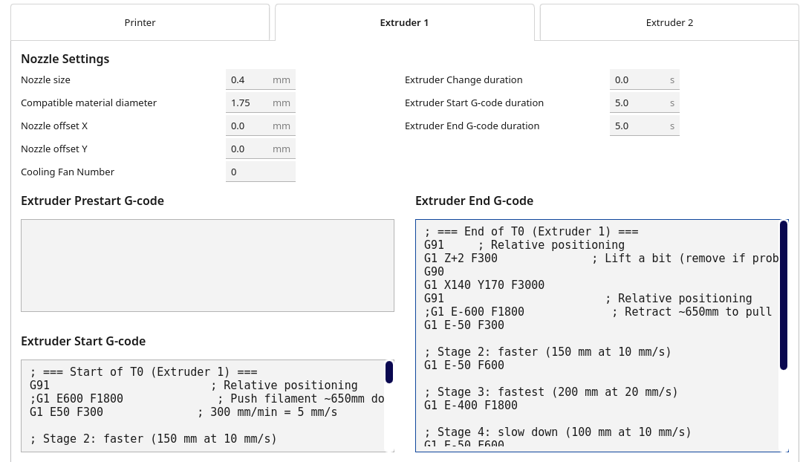
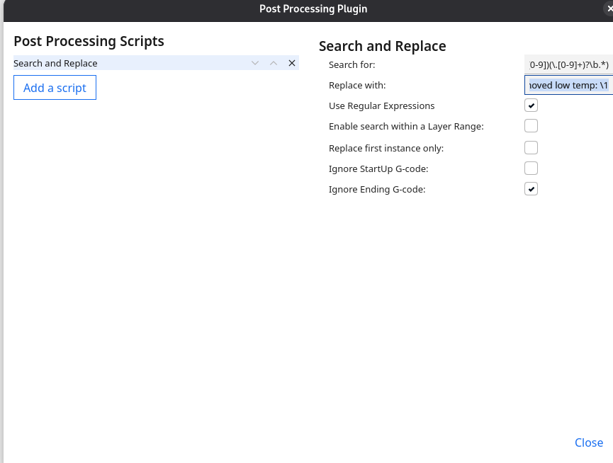
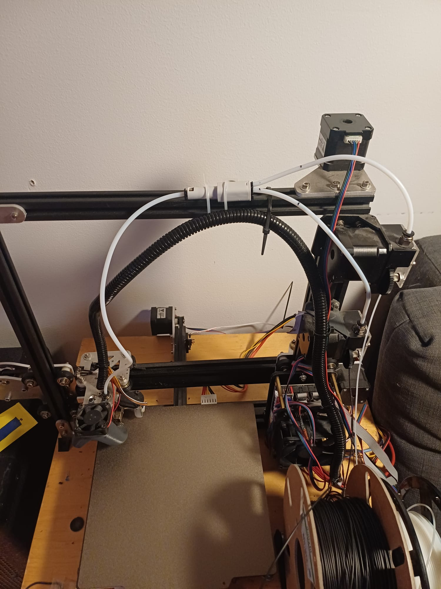

# Adding a Y-splitter to the Tevo Tarantula

My Tevo Tarantula was fitted stock with two extruders and two nozzles. Upon use, using two nozzles is really a pain: if they are not exactly level, one will impact on the print the other one is doing, lifting both nozzles and leaving "ghosts" unevenness… Even if they are perfectly level, the smallest defect during the print will have potential strong effect on the full print.

Because of this, I decided to change to a 2-extruders, one nozzle setup, the two extruders being linked to the hotend with a Y-splitter.

## Hardware
After some tries with some 3D printed ones, I landed on a 4-in-1 splitter from Bambu. While I was at it, I also changed all the bowden, the length of the one linking the splitter to the hot-end is 450mm (this is important for the configuration later).

I found out that I had to sligthly open the end of the bowden at the output of the splitter, otherwise the filament blocks there sometimes. I use a 3mm drill bit to make a cone profile there, works like a charm and does not add any slack in the filament path.

## Software

### Marlin
I configured Marlin to tell it that the extruders share the same nozzle and the same heater.

### Cura
Here comes the crux, and the reason for this post. Cura does not seem to completely support the fact that one printer, with two extruders, can have *one* heater, and one nozzle. So there are a few things to adjust.


#### Config file
First, in the Cura config file (from your folder: `.local/share/cura/5.xx/definition_changes/Tevo+Tarantula_settings.inst.cfg`) I added some single nozzle config at the end of the file:

```
machine_extruders_share_heater = True
machine_extruders_share_nozzle = True
```

Not sure this has a huge influence, but can't hurt to use whatever Cura is already doing for this setup.


#### Extruder 1 start G-code
This takes care of bringing the filament at the hot-end, before it is retracted beyond the Y-splitter. It features an accelerated move to not break the filament. All long retract/bring moves of the filaments are of 600mm. That's probably a tad much, but better to retract too much, and be sure there is no stray filament in the bowden.



```
; === Start of T0 (Extruder 1) ===
G91                        ; Relative positioning
;G1 E600 F1800              ; Push filament ~650mm down to the nozzle
G1 E50 F300              ; 300 mm/min = 5 mm/s

; Stage 2: faster (150 mm at 10 mm/s)
G1 E50 F600              ; 600 mm/min = 10 mm/s

; Stage 3: fastest (200 mm at 20 mm/s)
G1 E400 F1800             ; 1200 mm/min = 20 mm/s

; Stage 4: slow down (100 mm at 10 mm/s)
G1 E50 F600              ; 600 mm/min = 10 mm/s

; Stage 5: gentle finish (50 mm at 5 mm/s)
G1 E50 F300               ; 300 mm/min = 5 mm/s

;G1 E40 F600                ; Extra prime into nozzle (fine-tune this)
G90                        ; Back to absolute positioning

; Optional purge move – use a Prime Tower in Cura for better results
;G1 X140 Y170 F3000           ; Move near prime tower or purge location
G91
;G1 E10 F300                ; Small purge to ensure clean extrusion
G90
G92 E0      ; reset E to 0 after the load
; === Start T0 done ===
```


#### Extruder 1 end G-code

This takes care of bringing the filament back beyond the Y-splitter .

```
; === End of T0 (Extruder 1) ===
G91     ; Relative positioning
G1 Z+2 F300              ; Lift a bit (remove if problematic)
G90
G1 X140 Y170 F3000
G91                        ; Relative positioning
;G1 E-600 F1800             ; Retract ~650mm to pull filament out of hotend & Bowden
G1 E-50 F300

; Stage 2: faster (150 mm at 10 mm/s)
G1 E-50 F600

; Stage 3: fastest (200 mm at 20 mm/s)
G1 E-400 F1800

; Stage 4: slow down (100 mm at 10 mm/s)
G1 E-50 F600

; Stage 5: gentle finish (50 mm at 5 mm/s)
G1 E-50 F300
G90                        ; Back to absolute positioning

; Optional: small Z lift and park to reduce stringing during change
;G1 Z+0.5 F300              ; Lift nozzle a bit (if your firmware supports relative Z here)
;G1 X140 Y170 F6000           ; Move to a safe park position
; === End T0 done ===
```

#### Extruder 2 start G-code

Very similar

```
; === Start of T1 (Extruder 2) ===
G91                        ; Relative positioning
;G1 E600 F1800              ; Push filament ~650mm down to nozzle
G1 E50 F300              ; 300 mm/min = 5 mm/s

; Stage 2: faster (150 mm at 10 mm/s)
G1 E50 F600              ; 600 mm/min = 10 mm/s

; Stage 3: fastest (200 mm at 20 mm/s)
G1 E400 F1800             ; 1200 mm/min = 20 mm/s

; Stage 4: slow down (100 mm at 10 mm/s)
G1 E50 F600              ; 600 mm/min = 10 mm/s

; Stage 5: gentle finish (50 mm at 5 mm/s)
G1 E50 F300               ; 300 mm/min = 5 mm/s

;G1 E40 F600                ; Extra prime
G90                        ; Back to absolute positioning

; Optional purge
;G1 X140 Y170 F3000           ; Move near prime tower/purge zone
G91
;G1 E10 F300                ; Small purge
G90
G92 E0  ; reset E to 0 after the load
; === Start T1 done ===
```

#### Extruder 2 end G-code

```
; === End of T1 (Extruder 2) ===
G91     ; Relative positioning
G1 Z+0.5 F300              ; Lift a bit (remove if problematic)
G90
G1 X140 Y170 F3000
G91                        ; Relative positioning
;G1 E-600 F1800             ; Retract ~650mm from nozzle & Bowden
G1 E-50 F300

; Stage 2: faster (150 mm at 10 mm/s)
G1 E-50 F600

; Stage 3: fastest (200 mm at 20 mm/s)
G1 E-400 F1800

; Stage 4: slow down (100 mm at 10 mm/s)
G1 E-50 F600

; Stage 5: gentle finish (50 mm at 5 mm/s)
G1 E-50 F300
G90                        ; Back to absolute positioning

; Optional park move
;G1 Z+0.5 F300              ; Lift a bit (remove if problematic)
;G1 X140 Y170 F6000           ; Move to safe park position
; === End T1 done ===
```

#### Others

I put all the standby temperatures to 0, they shouldn't be called (but they were, see after). Nozzle Switch Retraction Distance to 0, as we are taking care of that ourselves. Nozzle Switch Extra Prime Amount to 3.0\,mm$^3$ but that might change.


Apparently, if you do not change the printer config file, Cura still issues some orders for a *second* heater, even though there is none. This can unfortunately be considered by Marlin, putting the nozzle at the standby temperature, for instance:

```
M104 S220
M104 T1 S175 ;; NO!!!!
```

To cure that (but that is unneeded now), you can use a post-processing script in Cura: Extensions>Post Processing>Modify G-code>Search and Replace.

Search for: `(M10[49]\s+T[01]\s+S([0-9]|[1-9][0-9]|1[0-4][0-9])(\.[0-9]+)?\b.*)`
Replace with: `;Removed low temp: \1`
Use Regexp: ticked.



But apparently I had to use that because I modified the config file on another Cura version, so Cura was not behaving okay. Does not hurt though.

This was a bit of tuning, but hoping that it will be more reliable than with two nozzles!




